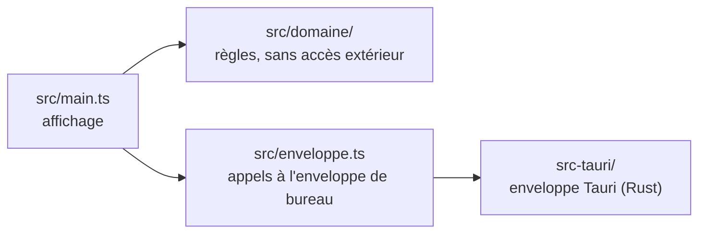

# DNMAX

DNMAX aide les enseignants de DN MADE à construire, suivre et restituer leurs évaluations par compétences à partir du référentiel du diplôme.

C'est une application de bureau autonome pour Windows, Linux et macOS : pas de serveur central, pas de compte, les données restent sur l'ordinateur de l'enseignant.

> **État** : squelette. L'application ouvre une fenêtre et affiche sa version ; les fonctions métier arrivent ensuite.

## Prérequis pour développer

- Node.js 22 et npm
- Rust (la version exacte est fixée par `rust-toolchain.toml` et installée automatiquement par `rustup`)
- Les bibliothèques système de Tauri. Sous Debian ou Ubuntu :

  ```bash
  sudo apt-get install libwebkit2gtk-4.1-dev libgtk-3-dev librsvg2-dev libayatana-appindicator3-dev
  ```

  Pour Windows et macOS, voir les [prérequis de Tauri](https://tauri.app/fr/start/prerequisites/).

## Installer

```bash
npm ci
```

## Lancer

```bash
npm run dev
```

## Tester et contrôler

| Contrôle | Commande |
| --- | --- |
| Tests | `npm test` |
| Linter | `npm run lint` |
| Typage | `npm run typecheck` |
| Format Rust | `cargo fmt --check` (dans `src-tauri/`) |
| Linter Rust | `cargo clippy --all-targets --locked -- -D warnings` (dans `src-tauri/`) |

## Construire un installeur

```bash
npm run build
```

Les installeurs sont produits dans `src-tauri/target/release/bundle/`, pour le système sur lequel la commande est lancée.

## Organisation du code



- `src/domaine/` : ce qui calcule. Aucune dépendance au navigateur ni à Tauri, donc testable directement.
- `src/enveloppe.ts` : ce qui parle à l'extérieur.
- `src/main.ts`, `index.html` : ce qui affiche.
- `src-tauri/` : la fenêtre de bureau et ses droits (`capabilities/`).

## Pièges déjà rencontrés

| Symptôme | Parade |
| --- | --- |
| `npm run lint` signale une erreur de type sur `import.meta.dirname` | `@types/node` doit être installé et listé dans `types` de `tsconfig.json`. |

## Documents

- [`DECISIONS.md`](DECISIONS.md) : choix techniques et leurs raisons.
- [`CHANGELOG.md`](CHANGELOG.md) : journal des modifications.

## Licence

[AGPL-3.0-or-later](LICENSE).
