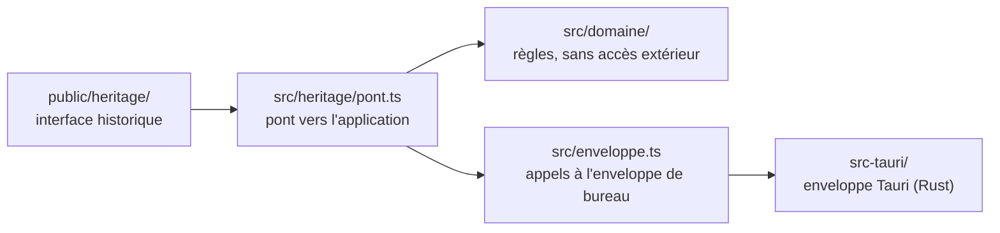

# DNMAX

DNMAX aide les enseignants de DN MADE à construire, suivre et restituer leurs évaluations par compétences à partir du référentiel du diplôme.

C'est une application de bureau autonome pour Windows, Linux et macOS : pas de serveur central, pas de compte, les données restent sur l'ordinateur de l'enseignant.

> **État** : utilisable pour des essais. Les enseignants peuvent s'échanger des évaluations, des référentiels et, dans un fichier chiffré, les résultats de leurs élèves. Ils peuvent aussi emporter toutes leurs données vers un autre ordinateur. Les mises à jour leur sont proposées au lancement (voir « Publier une version »).

## Où sont les données

Tout est enregistré dans un fichier chiffré, `coffre.dnmax`, protégé par le mot de passe choisi au premier lancement. Un dossier `sauvegardes/` voisin garde une copie chiffrée par jour d'utilisation (dix au plus).

| Système | Dossier |
| --- | --- |
| Windows | `%APPDATA%\fr.dnmax.app\` |
| macOS | `~/Library/Application Support/fr.dnmax.app/` |
| Linux | `~/.local/share/fr.dnmax.app/` |

Pour revenir à une sauvegarde : quitter l'application, puis copier le fichier voulu de `sauvegardes/` à la place de `coffre.dnmax`. Le mot de passe reste celui en vigueur le jour de la sauvegarde.

Les documents exportés (Word, Excel, OpenDocument) ne sont **pas** chiffrés. Le détail de la protection et de ses limites est dans [`DECISIONS.md`](DECISIONS.md), décision 8.

## Prérequis pour développer

- Node.js 22 et npm
- Rust (la version exacte est fixée par `rust-toolchain.toml` et installée automatiquement par `rustup`)
- Les bibliothèques système de Tauri. Sous Debian ou Ubuntu :

  ```bash
  sudo apt-get install libwebkit2gtk-4.1-dev libgtk-3-dev librsvg2-dev libayatana-appindicator3-dev
  ```

  Pour Windows et macOS, voir les [prérequis de Tauri](https://tauri.app/fr/start/prerequisites/).

## Installer

```bash
npm ci
```

## Lancer

```bash
npm run dev
```

## Tester et contrôler

| Contrôle | Commande |
| --- | --- |
| Tests | `npm test` |
| Linter | `npm run lint` |
| Typage | `npm run typecheck` |
| Format Rust | `cargo fmt --check` (dans `src-tauri/`) |
| Tests Rust | `cargo test --locked` (dans `src-tauri/`) |
| Linter Rust | `cargo clippy --all-targets --locked -- -D warnings` (dans `src-tauri/`) |

## Construire un installeur

```bash
npm run build
```

Les installeurs sont produits dans `src-tauri/target/release/bundle/`, pour le système sur lequel la commande est lancée.

Pour obtenir les installeurs des trois systèmes sans les construire soi-même : onglet « Actions » du dépôt, atelier « Installeurs », bouton « Run workflow ». Ils sont joints à l'exécution, en bas de sa page. Pousser une branche nommée `essai-installeurs/…` déclenche le même atelier.

### Installer une version d'essai (non signée)

- **Windows** : à l'avertissement « Windows a protégé votre ordinateur », cliquer « Informations complémentaires » puis « Exécuter quand même ».
- **macOS** : au premier lancement refusé, ouvrir Réglages Système → Confidentialité et sécurité, puis « Ouvrir quand même ».
- **Linux** : installer le `.deb`, ou rendre le fichier `.AppImage` exécutable et le lancer.

## Publier une version

### Une seule fois : la clé de signature des mises à jour

1. Sur votre ordinateur, dans le dépôt :

   ```bash
   npx tauri signer generate -w ~/.tauri/dnmax.key
   ```

   La commande demande un mot de passe et crée deux fichiers : `dnmax.key` (clé privée, **à ne jamais copier dans le dépôt ni dans une conversation**) et `dnmax.key.pub` (clé publique).
2. Sur GitHub, dans Settings → Secrets and variables → Actions, créer deux secrets : `TAURI_SIGNING_PRIVATE_KEY` (contenu de `dnmax.key`) et `TAURI_SIGNING_PRIVATE_KEY_PASSWORD` (le mot de passe).
3. Copier le contenu de `dnmax.key.pub` dans `plugins.updater.pubkey` de `src-tauri/tauri.conf.json`, par une branche comme tout changement.
4. Conserver `dnmax.key` et son mot de passe en lieu sûr : sans eux, plus aucune mise à jour ne sera acceptée par les postes déjà installés.

### À chaque version

1. Sur une branche : monter le numéro de version dans `package.json` **et** `src-tauri/Cargo.toml` (puis `npm install` et `cargo check` pour mettre à jour les fichiers de verrouillage), dater la section du `CHANGELOG.md`, et mettre à jour la version proposée par défaut dans le formulaire « Idées et bugs » de `site/index.html`. Fusionner.
2. Sur GitHub, onglet Actions → atelier « Publication » → « Run workflow » sur la branche `main`.
3. L'atelier construit, signe et crée un **brouillon** de version (onglet Releases). Essayer les installeurs.
4. Publier le brouillon : GitHub pose l'étiquette `v…` et les postes déjà installés proposeront la mise à jour à leur prochain lancement.

Si la construction macOS est annulée faute de machine disponible chez GitHub, relancer les jobs en échec depuis la page de l'exécution (« Re-run failed jobs »).

Sous Linux, seule l'AppImage se met à jour d'elle-même.

## Site web

Le dossier `site/` contient le site public de DNMAX (<https://dnmax.fr>) : une page unique, sans étape de construction, et les référentiels proposés au téléchargement (`site/referentiels/`). Il est hébergé chez OVH ; `site/.htaccess` règle le serveur (HTTPS, téléchargement des référentiels).

Le site se publie **à la main**, par FTP, après chaque fusion qui touche `site/` :

1. Dans l'espace client OVH, onglet « FTP-SSH » de l'hébergement : relever le serveur FTP et l'identifiant (le mot de passe se change au même endroit).
2. Dans un client FTP (FileZilla, par exemple), choisir **« Connexion FTP explicite sur TLS »** : jamais de FTP en clair, qui ferait circuler le mot de passe lisiblement.
3. Copier le **contenu** du dossier `site/` dans le dossier `www` du serveur, en remplaçant les fichiers existants, **y compris `.htaccess`** (fichier caché : afficher les fichiers cachés si besoin). `_headers` ne sert qu'à Cloudflare et peut être ignoré.
4. Supprimer côté serveur un fichier retiré du dépôt, s'il y en a un.
5. Vérifier <https://dnmax.fr>, puis <http://dnmax.fr> et <https://www.dnmax.fr>, qui doivent rediriger vers la première.

Le formulaire « Idées et bugs » de la page ouvre un ticket prérempli sur GitHub.

Les boutons de téléchargement pointent sur des fichiers à nom fixe de la dernière version publiée (`DNMAX-windows.exe`, `DNMAX-macos.dmg`, `DNMAX-linux.AppImage`, `DNMAX-linux.deb`), que l'atelier « Publication » joint à chaque version.

## Organisation du code



- `public/heritage/` et `index.html` : l'interface historique, reprise telle quelle (voir `DECISIONS.md`, décision 5).
- `src/heritage/pont.ts` : ce que l'application fournit à l'interface historique (stockage, enregistrement de fichiers).
- `src/domaine/` : ce qui calcule. Aucune dépendance au navigateur ni à Tauri, donc testable directement.
- `src/enveloppe.ts` : ce qui parle à l'extérieur.
- `src/ecran-coffre.ts` : l'écran de mot de passe.
- `src/ecran-compte.ts` : « Mon compte » (nom, mot de passe, à propos). `src/ecran-exemple.ts` : le retrait de l'exemple.
- `src/ecran-accueil.ts` : l'encart des premiers pas sur une installation vide. `src/configuration.ts` : les adresses publiques du projet.
- `src/ecran-mise-a-jour.ts` : l'annonce d'une mise à jour. `outils/` : le compositeur du manifeste de mise à jour, utilisé par l'atelier « Publication ».
- `src/domaine/echange/` : les règles de l'échange entre enseignants (format du fichier, empreinte du référentiel, plan d'import). `src/ecran-echange.ts` : ses écrans.
- `src-tauri/` : la fenêtre de bureau et ses droits (`capabilities/`). Dans `src-tauri/src/` : `coffre.rs` chiffre (sans toucher au disque), `depot.rs` range les fichiers (sans connaître le chiffrement), `export.rs` écrit les exports, `lib.rs` relie le tout aux commandes appelées par l'interface.

## Pièges déjà rencontrés

| Symptôme | Parade |
| --- | --- |
| Une commande Rust reçoit du JSON alors que l'interface a envoyé des octets | Sous Linux, Tauri transmet un envoi binaire comme une liste JSON de nombres : accepter les deux formes (voir `extraire_octets`). |
| Deux référentiels différents ont la même empreinte | Le référentiel enregistré ne contient que des identifiants ; les libellés sont dans un dictionnaire à part. Empreinter le contenu lisible fourni par `projeterReferentiel`, jamais la structure enregistrée. |
| Sur une installation neuve, l'échange ne trouve aucun diplôme | L'interface historique n'enregistrait `dnmade.data` qu'à la première modification ; `persistData()` est appelé en fin de script pour l'inscrire dès le chargement. |
| En intégration continue, l'étape des bibliothèques système reste bloquée jusqu'au délai du job | Le miroir de paquets par défaut des machines GitHub ne répond pas. Les ateliers passent par `outils/installer-bibliotheques-linux.sh`, qui sonde plusieurs miroirs et retient le premier qui répond. |
| Les tests du chiffrement sont lents | Leur passer `DERIVATION_DE_TEST` (coût minimal), jamais `PARAMETRES_PAR_DEFAUT`. |
| Changer `document.title` ne change pas le titre de la fenêtre | Le fixer côté Rust avec `set_title`. |
| `npm run lint` signale une erreur de type sur `import.meta.dirname` | `@types/node` doit être installé et listé dans `types` de `tsconfig.json`. |

## Documents

- [`DECISIONS.md`](DECISIONS.md) : choix techniques et leurs raisons.
- [`CHANGELOG.md`](CHANGELOG.md) : journal des modifications.

## Licence

[AGPL-3.0-or-later](LICENSE).
