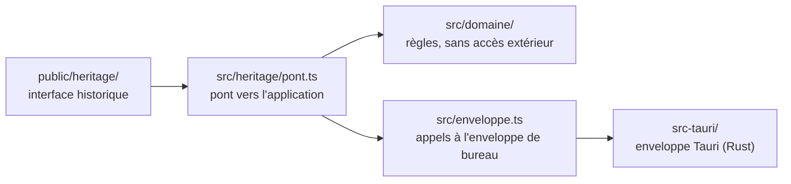

# DNMAX

DNMAX aide les enseignants de DN MADE à construire, suivre et restituer leurs évaluations par compétences à partir du référentiel du diplôme.

C'est une application de bureau autonome pour Windows, Linux et macOS : pas de serveur central, pas de compte, les données restent sur l'ordinateur de l'enseignant.

> **État** : utilisable pour des essais. Les enseignants peuvent s'échanger des évaluations (sans élèves). Manquent encore l'échange du référentiel et des résultats, et la mise à jour automatique.

## Où sont les données

Tout est enregistré dans un fichier chiffré, `coffre.dnmax`, protégé par le mot de passe choisi au premier lancement. Un dossier `sauvegardes/` voisin garde une copie chiffrée par jour d'utilisation (dix au plus).

| Système | Dossier |
| --- | --- |
| Windows | `%APPDATA%\fr.dnmax.app\` |
| macOS | `~/Library/Application Support/fr.dnmax.app/` |
| Linux | `~/.local/share/fr.dnmax.app/` |

Pour revenir à une sauvegarde : quitter l'application, puis copier le fichier voulu de `sauvegardes/` à la place de `coffre.dnmax`. Le mot de passe reste celui en vigueur le jour de la sauvegarde.

Les documents exportés (Word, Excel, OpenDocument) ne sont **pas** chiffrés. Le détail de la protection et de ses limites est dans [`DECISIONS.md`](DECISIONS.md), décision 8.

## Prérequis pour développer

- Node.js 22 et npm
- Rust (la version exacte est fixée par `rust-toolchain.toml` et installée automatiquement par `rustup`)
- Les bibliothèques système de Tauri. Sous Debian ou Ubuntu :

  ```bash
  sudo apt-get install libwebkit2gtk-4.1-dev libgtk-3-dev librsvg2-dev libayatana-appindicator3-dev
  ```

  Pour Windows et macOS, voir les [prérequis de Tauri](https://tauri.app/fr/start/prerequisites/).

## Installer

```bash
npm ci
```

## Lancer

```bash
npm run dev
```

## Tester et contrôler

| Contrôle | Commande |
| --- | --- |
| Tests | `npm test` |
| Linter | `npm run lint` |
| Typage | `npm run typecheck` |
| Format Rust | `cargo fmt --check` (dans `src-tauri/`) |
| Tests Rust | `cargo test --locked` (dans `src-tauri/`) |
| Linter Rust | `cargo clippy --all-targets --locked -- -D warnings` (dans `src-tauri/`) |

## Construire un installeur

```bash
npm run build
```

Les installeurs sont produits dans `src-tauri/target/release/bundle/`, pour le système sur lequel la commande est lancée.

Pour obtenir les installeurs des trois systèmes sans les construire soi-même : onglet « Actions » du dépôt, atelier « Installeurs », bouton « Run workflow ». Ils sont joints à l'exécution, en bas de sa page. Pousser une branche nommée `essai-installeurs/…` déclenche le même atelier.

### Installer une version d'essai (non signée)

- **Windows** : à l'avertissement « Windows a protégé votre ordinateur », cliquer « Informations complémentaires » puis « Exécuter quand même ».
- **macOS** : au premier lancement refusé, ouvrir Réglages Système → Confidentialité et sécurité, puis « Ouvrir quand même ».
- **Linux** : installer le `.deb`, ou rendre le fichier `.AppImage` exécutable et le lancer.

## Organisation du code



- `public/heritage/` et `index.html` : l'interface historique, reprise telle quelle (voir `DECISIONS.md`, décision 5).
- `src/heritage/pont.ts` : ce que l'application fournit à l'interface historique (stockage, enregistrement de fichiers).
- `src/domaine/` : ce qui calcule. Aucune dépendance au navigateur ni à Tauri, donc testable directement.
- `src/enveloppe.ts` : ce qui parle à l'extérieur.
- `src/ecran-coffre.ts` : l'écran de mot de passe.
- `src/domaine/echange/` : les règles de l'échange entre enseignants (format du fichier, empreinte du référentiel, plan d'import). `src/ecran-echange.ts` : ses écrans.
- `src-tauri/` : la fenêtre de bureau et ses droits (`capabilities/`). Dans `src-tauri/src/` : `coffre.rs` chiffre (sans toucher au disque), `depot.rs` range les fichiers (sans connaître le chiffrement), `export.rs` écrit les exports, `lib.rs` relie le tout aux commandes appelées par l'interface.

## Pièges déjà rencontrés

| Symptôme | Parade |
| --- | --- |
| Une commande Rust reçoit du JSON alors que l'interface a envoyé des octets | Sous Linux, Tauri transmet un envoi binaire comme une liste JSON de nombres : accepter les deux formes (voir `extraire_octets`). |
| Deux référentiels différents ont la même empreinte | Le référentiel enregistré ne contient que des identifiants ; les libellés sont dans un dictionnaire à part. Empreinter le contenu lisible fourni par `projeterReferentiel`, jamais la structure enregistrée. |
| Les tests du chiffrement sont lents | Leur passer `DERIVATION_DE_TEST` (coût minimal), jamais `PARAMETRES_PAR_DEFAUT`. |
| Changer `document.title` ne change pas le titre de la fenêtre | Le fixer côté Rust avec `set_title`. |
| `npm run lint` signale une erreur de type sur `import.meta.dirname` | `@types/node` doit être installé et listé dans `types` de `tsconfig.json`. |

## Documents

- [`DECISIONS.md`](DECISIONS.md) : choix techniques et leurs raisons.
- [`CHANGELOG.md`](CHANGELOG.md) : journal des modifications.

## Licence

[AGPL-3.0-or-later](LICENSE).
